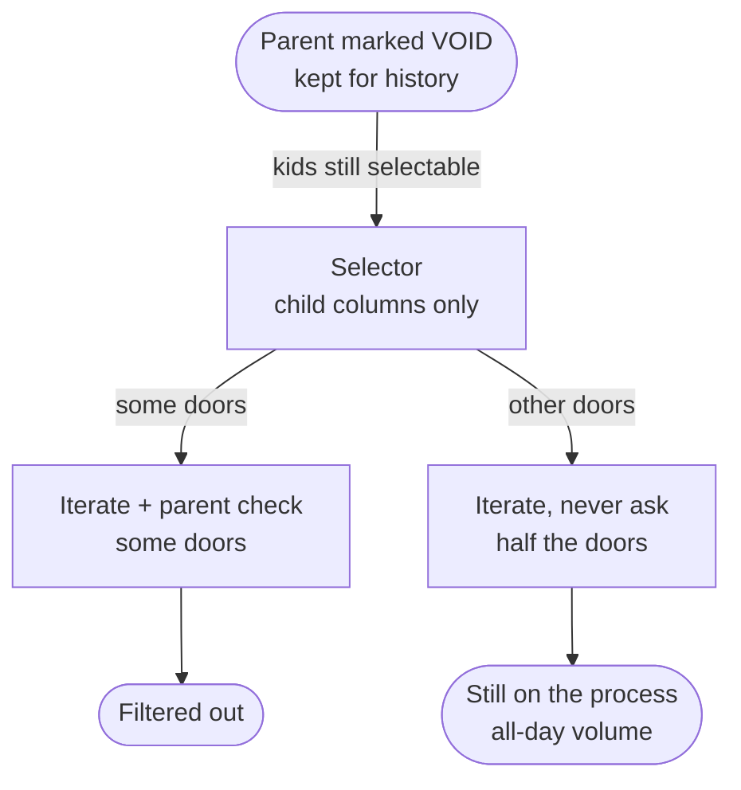

# Your children will outlive your influence (and your status)

### Notes on eligibility leakage

*What I noticed when a tombstoned parent still counted as "already here," and the kids kept getting invited to a process that runs all day — in one messy system I help maintain*

---

Parenting books will tell you your children will outlive your influence. I ran into the row version of that sentence on a screen that was supposed to be boring.

Before the app would let you create another parent of a particular kind, it asked whether one already existed. Existence was the gate. A voided historical parent still counted. The UI never treated null-and-void as ineligible for that check. Keeping the row for history was correct. Letting a tombstone answer a live workflow question was the smell.

I did not set out to write about child records. I set out to explain why a parent we had already walked out of the live world could still show up as already here. That doorway is where the rest of the house stopped looking tidy.

## The sentence that owned the mess

I was staring at one of those child-select paths, a scrubbed cousin of what you see below, trying to explain why a voided root still fed the daily run, when people who had known about the investigation the whole time said the rule out loud.

Voiding the parent was only supposed to be allowed if those kids had never been through the process.

Not a code comment. Policy that lived in heads. Void was never a free sanitization of the root. It was conditional on the kids having no history with the critical job. Influence was supposed to run both ways.

That is the question I cannot put down: who decides the kids are still eligible after the parent leaves? In code it was not one answer. It was whichever door you walked through that day.

## Then I followed the kids

Once the root was in my head, the children were hard to miss. We had marked the aggregate null and void on purpose. We had not deleted it. Its child records kept showing up as eligible for a process that runs all day.

Less like orphans. More like the neighborhood kids who are always at someone else's house.

One path knew how to sanitize the root. Other paths knew how to pick children for the critical job. The pickers asked whether the child looked ready. None of them joined back to the parent. The invite list came back from child columns alone. Whether anyone asked if the parent was still live happened later, if it happened at all, while code walked the results.

DRY left this project decades ago. There were more porches than I wanted to count, same shape in spirit: pull the kids, then iterate. Which copy ran depended on the door. Only some of the walks still asked whether the parent was still live. About half the doors still treated those children as welcome after the parent was out of play.

A child-level filter is easy to write. A parent check inside the loop is one more round trip, one more null case, one more thing to forget under deadline when you are pasting the next house on the block. Voiding the parent became a suggestion the iterate step was free to skip.

That is when I started calling it **eligibility leakage**: child rows still welcome at the process after their aggregate root had been sanitized out of the live world. Root sanitized. Children still eligible. The status on the parent had been flipped on the assumption they would take the hint.

## One file that would not explain itself

Anonymized hard. Renamed tables, flags, and identifiers. This is the shape I kept opening, not a blog toy, the skeleton of a production pick for the daily run:

```sql
SELECT c.ChildId, c.ParentId, c.ReadyFlag, c.EffectiveDt
FROM dbo.ChildReady c
WHERE c.ReadyFlag = 'Y'
  AND c.EffectiveDt <= @AsOf
  AND c.PurgeDt IS NULL;
```

No join to the parent. No live-status predicate. Child columns only. Then the host loop, scrubbed C# cousin of what sat above that result set:

```csharp
foreach (var kid in results)
{
    // Door A: if (LookupParent(kid.ParentId)?.LiveStatus == LiveStatus.Void) continue;
    // Door B: Schedule(kid);  // never asks
}
```

Same invite list. Different weather on the walk. Door A filtered them out. Door B kept them on the calendar. I counted once, got a number that made me stop counting, and after that I just said half the doors still invited.





## When quiet stopped feeling quiet

If the process ran once a quarter, you might catch the odd wrong invite in recon and invent an edge-case story. At all-day volume, wrong eligibility becomes weather. You stop asking whether it happened and start asking how much of the day was built on children whose parent had already left the building.

Checking the parent on every row can be expensive. Fine. Then pick one path that owns the tradeoff, or put the question where the invite is built. A block of selectors with half the loops skipping the check is not a performance strategy.

Tombstones should keep history. Agreed on the root. History does not require the kids to stay process-eligible. Cascade ineligible, reparent, or write down that they stay. Silence is how the resume stays current.

Oral rules work until the next door, the next paste, the next void the screen allows. That is how you get walks that filtered them out and walks that still invited.

## What I started wanting

Not enforced where I work.

- Existence checks treat voided historical parents as ineligible for live workflow questions
- One owned path from child select through iterate that decides parent liveness
- The void rule written next to the status flag, not only in heads
- Voiding a root carries an explicit child policy: cascade ineligible, reparent, or documented stay

Three questions before I trust the next selector:

1. When this root is voided, who is still eligible?
2. How many child-select-plus-iterate paths skip parent liveness?
3. If this process runs all day, can wrong eligibility stay rare?

## Home

The parent left the live world on purpose. The children kept their invitations. History on the root was preserved. Meaning in the process was not. Home went dark. Half the block still had them over.

As a parent, I can only hope that my children are as tenacious and impactful as these child records. Then I hope the next walk through the results asks whether they are supposed to be home.

---

*Disclaimer: This post was crafted as a joint venture between myself, Herald, and Jarvis.*
